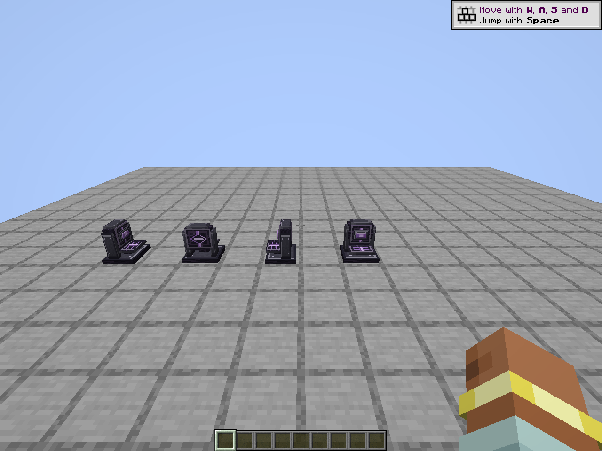
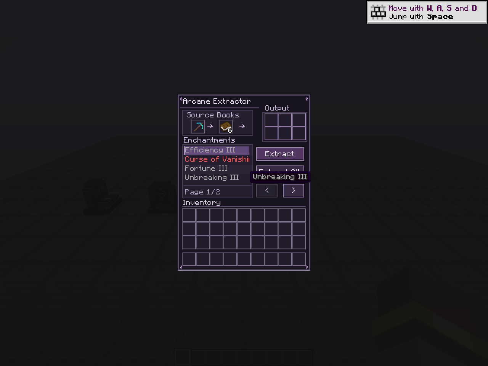

# Arcane Extraction

A NeoForge mod for Minecraft 1.21.1 that adds the **Arcane Extractor**, a medieval-magic workstation. It moves one chosen enchantment from an enchanted item onto an ordinary book, keeping the exact enchantment level and all unrelated item state.



## Requirements

| | Version |
|---|---|
| Minecraft | 1.21.1 |
| NeoForge | 21.1.252 or newer (tested on 21.1.252) |
| Java | 21 |

The mod is required on **both the client and the dedicated server**: it registers a block, a menu, a network payload and resources.

## Installation

1. Download `arcane_extraction-1.0.1.jar` from the [Releases page](https://github.com/nullps1/Arcane-Extractor/releases).
2. Put the JAR in the `mods` folder of your NeoForge client and, for multiplayer, of the server.
3. Launch Minecraft 1.21.1 with NeoForge.

Each release lists the SHA-256 of its JAR; compare it with the file you downloaded.

## Current version: 1.0.1

v1.0.1 fixes a crash with Quark's Ancient Tomes. Extraction used to remove an item's anvil prior-work penalty (`repair_cost`) component; it now resets the value to `0`. Items extracted with v1.0.0 can be repaired with the command in the [changelog](docs/CHANGELOG.md). Full history is in the [changelog](docs/CHANGELOG.md).

## Features

- Select one exact enchantment by registry ID and extract it onto a book.
- Exact level preservation, including above-normal levels. Curses, treasure and modded or data-driven enchantments are supported when they use Minecraft's standard enchantment component.
- **Extract All** repeats the extraction until books, enchantments or free output slots run out.
- Six-slot output buffer for the finished enchanted books.
- Hopper and pipe automation: valid items go in, finished books come out of all six outputs, and the inputs cannot be pulled out.
- Server-authoritative: the client only asks, and the server validates every request.
- Contents persist through save, reload and restart.



## Crafting

```
O A O      O = Crying Obsidian
A E A      A = Amethyst Shard
O A O      E = Enchanting Table
```

## How it works

Input: one enchanted source item, one ordinary book and one selected enchantment.

Output: a copy of the source item with only that enchantment removed, and one enchanted book carrying exactly that enchantment and level.

Each successful extraction consumes one book and resets the source item's anvil prior-work penalty. No XP or custom currency is required.

## Known limitations

- Targets Minecraft 1.21.1 / NeoForge 21.1.x only.
- Mods that keep enchantments outside Minecraft's standard enchantment component are not supported.
- Automated tests cover the extraction engine, the automation handler and the transaction logic. Multiplayer and dedicated-server behavior was verified by hand (see [the pre-release test plan](docs/PRE_RELEASE_TEST_PLAN.md)); there are no automated GameTests yet.
- Compatibility with other mods is best-effort. The Quark crash fixed in 1.0.1 was found in a real modpack, so please report interactions you run into.

## Building from source

Requires JDK 21. The Gradle wrapper (Gradle 9.2.1) is included, and its distribution download is verified by SHA-256 in `gradle/wrapper/gradle-wrapper.properties`.

```bash
./gradlew build        # Linux/macOS
.\gradlew.bat build    # Windows PowerShell
```

The mod JAR is written to `build/libs/arcane_extraction-1.0.1.jar` and the tests run as part of the build. See [docs/TESTING.md](docs/TESTING.md).

Toolchain: ModDevGradle 2.0.147, Parchment 2024.11.17 mappings, JUnit 5.11.4.

## Documentation

- [Architecture](docs/ARCHITECTURE.md)
- [Compatibility contract](docs/COMPATIBILITY.md)
- [Testing](docs/TESTING.md)
- [Milestones](docs/MILESTONES.md)
- [M7 visuals and validation](docs/M7_VISUALS.md)
- [Pre-release test plan](docs/PRE_RELEASE_TEST_PLAN.md)
- [v1.0.0 release notes](docs/RELEASE_1.0.0.md)
- [Changelog](docs/CHANGELOG.md)

## Security

See [SECURITY.md](SECURITY.md) for how to report a vulnerability.

## License

[MIT](LICENSE) © 2026 nullps1
