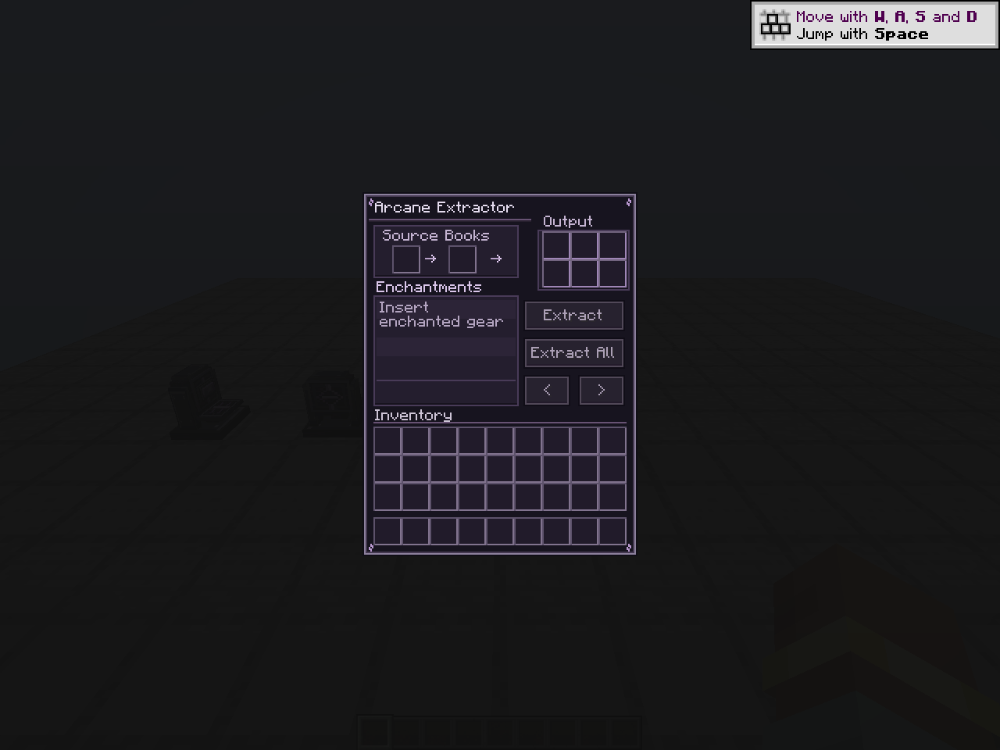
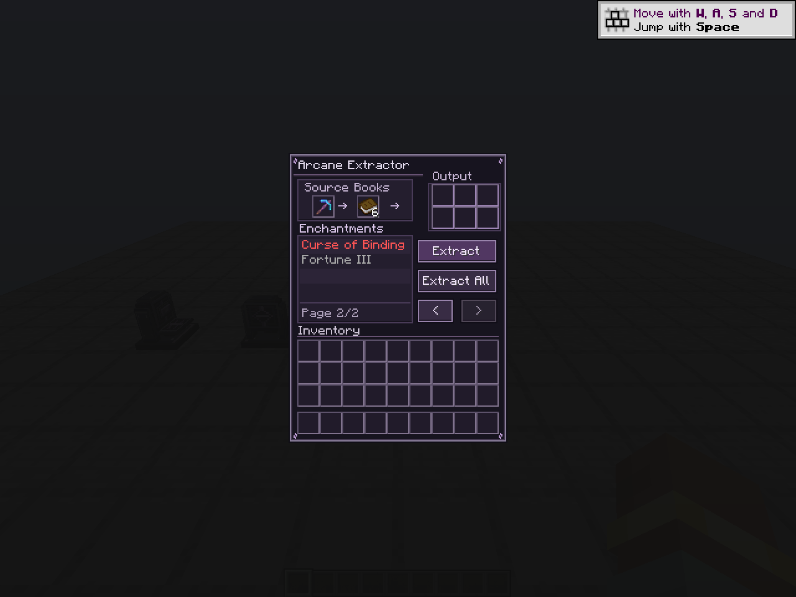
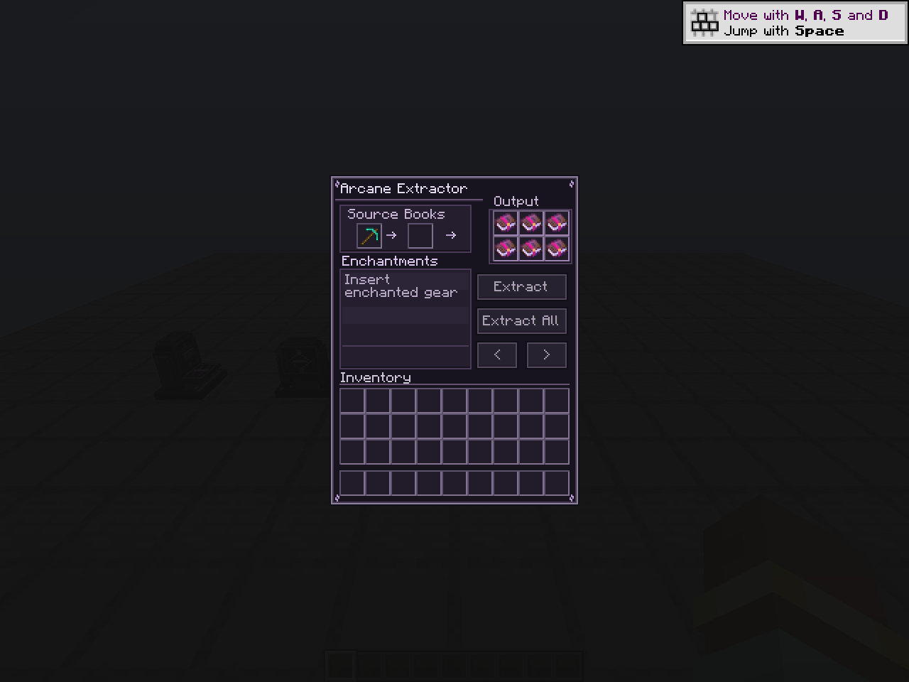

# M7 visual release

## Design

The approved standing workstation direction is implemented as a one-block obsidian apparatus with a low plinth, two metal/stone supports, an engraved upright housing, an amethyst lens, and a front input shelf. The model has 11 axis-aligned cuboids and four horizontal facings. It uses standard Minecraft baked rendering and a 3D item inherited from the block model.

All five 16x16 textures are original pixel art, generated deterministically by `tools/generate_visual_assets.py`: obsidian, trim, rune, amethyst, and deck. Purple highlights are painted; they do not require emissive shaders or introduce a new light source. The generator requires Python 3 and Pillow; normal builds use committed resources.

The GUI uses an original 256x256 atlas with a 176x233 visible region. Source/books, the 3x2 result shelf, enchantment ledger, and player inventory have distinct frames. Primary/secondary buttons retain vanilla interaction and narration. A selected row has a bright edge and purple fill; curse text retains Minecraft styling. Long names are clipped within the ledger and available in full on hover. The empty prompt wraps inside the ledger.

## Compatibility boundary

- All eight machine and 36 player slot positions/indices are unchanged from M6.
- No changes to menu routing, extraction transactions, registry-ID payloads, source/item components, automation, inventory serialization/migration, recipe, loot, sounds, or particles.
- Existing block IDs resolve to the same block. Pre-M7 saved states lacking `facing` default north; no inventory migration is introduced.
- Rotation/mirroring changes the model and shape only. Open geometry is non-occluding.
- This is a snapshot visual release candidate. No tag, publication, or automatic merge is part of M7.

## Validation record — 2026-09-27

Environment: Minecraft 1.21.1, NeoForge 21.1.252, Java 21.0.12.1, Windows 11, NVIDIA GTX 1050; no external mods or resource packs.

- `gradlew build` passed: **25 tests, zero failures**, including the unchanged M1–M6 regression suite and four M7 resource/shape/save-state tests.
- M7 tests compare all four rendered model rotations with outline/collision shapes, verify rotation/mirroring, deserialize an old block palette without facing, round-trip current facings, and check texture references, PNG sizes, item inheritance, and GUI atlas opacity.
- A temporary development-only harness created a fresh flat integrated-server world and captured the actual client at 1280x960, GUI scale 2. It opened the real menu, populated six enchantments/books, selected a row, paged, and clicked Extract then Extract All through the screen. The server confirmed all six output slots contained enchanted books and no input books remained. This is a visual/interaction smoke test, not a substitute for exact-ID and modpack/multiplayer acceptance.
- The harness is excluded from the final mod JAR. Screenshots below are actual Minecraft renders, not concept mockups.
- Dedicated-server smoke: `runServer` reached `Done` on a local-only development server, with no client-class linkage failures.
- Final JAR inspection confirmed all six PNGs plus model/blockstates are packaged, with no development harness classes. Regenerating the assets produced byte-for-byte identical resources.
- Local artifact: `build/libs/arcane_extraction-0.1.0-SNAPSHOT.jar`, SHA-256 `53446c3be25377c88d06986d8fe4b615b8defaa0fe801d17cb4408c429b531e7`. This hash identifies the local Windows build, not a claim that a separate CI build has identical bytes.

## Remaining release acceptance

The owner reported M6 live acceptance on 2026-09-27; the exact pack/environment was not recorded here. Final visual approval, placement from every direction, item hand/ground/frame rendering, custom resource packs, other languages, real modded long names, two-player concurrency, automation, and a populated legacy-world upgrade must be accepted in the intended pack. Use [Gate J](PRE_RELEASE_TEST_PLAN.md#gate-j--m7-visual-acceptance) and record the final JAR hash and pack versions. Do not mark these manual gates passed based solely on automated tests or screenshots.
